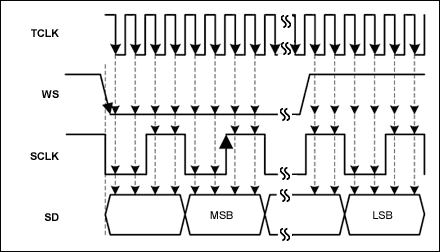
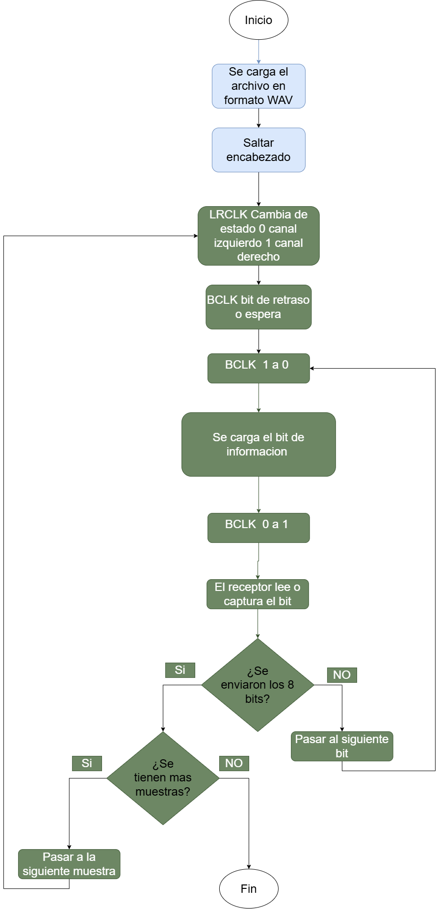
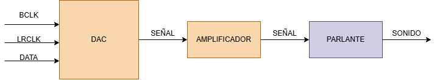

# I2S_TX — Periférico de audio de KUBIX

Equipo I (Electrónica Digital I, UNAL): José Miguel Ramírez Rubiano, Gabriela Gordillo Camacho y Miguel Ángel Pinto.

`perip_i2s` es el periférico de audio de la consola KUBIX. Recibe muestras de 8 bits desde el procesador femtoRV32 por el bus CSR, las guarda en una FIFO y las transmite por I2S a un **MAX98357A**, que hace de DAC y amplificador y mueve el parlante.

### Estado del avance

| Entregable | Estado |
|---|---|
| Especificación: función, registros CSR, errores y parámetros | Lista (§3) |
| Diagrama de flujo | Borrador (§6) |
| Diagramas de bloques y de estados | Pendiente |
| RTL, testbenches y driver en C | Pendiente |
| Placa, `FCIA_FPGA` y región de la flash | Por definir con integración y el grupo D |

---

## 1. Protocolo I2S

I2S (*Inter-IC Sound*) es un bus serie síncrono diseñado para transmitir audio digital [1]. Usa tres líneas y, de forma opcional, una cuarta:

| Señal | Función |
|---|---|
| **BCLK** (reloj de bit) | Marca cada bit. El transmisor cambia el dato en el flanco de bajada y el receptor lo lee en el de subida. |
| **LRCLK** (reloj de palabra, WS) | Indica el canal: 0 = izquierdo, 1 = derecho. Su frecuencia es la de muestreo, $F_s$. |
| **SD** (datos) | Las muestras PCM, MSB primero, en complemento a 2. El MSB sale **un ciclo de BCLK después** del cambio de LRCLK. |
| **MCLK** (reloj maestro) | Opcional. Muchos conversores lo usan a $256\,F_s$ para su sobremuestreo interno. **El MAX98357A no lo necesita** [2]. |

$$
f_{BCLK} = F_s \cdot W \cdot N_c
$$

donde $W$ es el número de ciclos de BCLK por canal (el *slot*) y $N_c = 2$ el número de canales. Como el reloj de bit depende de $F_s$, el audio se reproduce a la velocidad exacta con la que se muestreó.

<p align="center"></p>

---

## 2. Formato del audio

Para que la FPGA no tenga que interpretar el encabezado WAV, todo el audio de la consola se convierte de antemano a un formato fijo:

| Parámetro | Valor |
|---|---|
| Frecuencia de muestreo | 44.1 kHz nominal (real: $FS_{REAL}$, §5.1) |
| Resolución | 8 bits |
| Canales | 1 (mono) |
| Codificación | la de un WAV de 8 bits: sin signo, silencio = 128 (`0x80`) |
| Encabezado | ninguno: solo las muestras |

En un WAV de 8 bits las muestras no tienen signo, y el silencio vale 128. I2S necesita complemento a 2, así que la conversión es $s = u - 128$, que equivale a **invertir el bit 7**. Esa inversión la hace el periférico. El detalle del formato WAV está en [`docs/formato_wav.md`](docs/formato_wav.md).

**Conversión** (los archivos de `I2S_sonidos` están en 16 bits y algunos en estéreo):

```bash
ffmpeg -i entrada.wav -ac 1 -ar 43403 -f u8 salida.raw
```

**Tamaño.** Después de convertir, el audio ocupa $FS_{REAL} \times 1\ \text{B} \approx 43.4$ kB por segundo:

| Contenido de `I2S_sonidos` | Duración | Tamaño a 16 bits  | Tamaño a 8 bits mono |
|---|---|---|---|
| Efectos (colisiones, disparos, PONG…) | 8.5 s | ≈ 0.75 MB | **≈ 0.37 MB** |
| Música e intros | 233 s | ≈ 24.3 MB | **≈ 10.1 MB** |
| Total | 242 s | 25.0 MB | **≈ 10.5 MB** |

los audios ya en tamaño de o bits y mono se encuentran en la carpeta `I2S_Sonidos_8bits`, estos se pudieron convertir facilmente al formato deseado con ayuda de inteligencia artificial.

---

## 3. Especificación del periférico

### 3.1 Parámetros

| Parámetro | Símbolo | Valor |
|---|---|---|
| Frecuencia de muestreo | $FS_{REAL}$ | $FCIA\_FPGA / (32 \cdot DIV)$; 43 402.8 Hz con 25 MHz |
| Resolución | $N$ | 8 bits |
| Canales | — | mono, la misma muestra en L y R |
| Ancho de slot | $W$ | 16: la muestra va en los 8 bits altos y el resto se rellena con ceros |
| Reloj de bit | $f_{BCLK}$ | $2 \cdot 16 \cdot FS_{REAL} = 32 \cdot FS_{REAL}$ |

**Por qué el slot es de 16 bits:** el MAX98357A solo acepta palabras de 16, 24 o 32 bits y BCLK = 32, 48 o 64 × LRCLK [2]. En I2S el MSB tiene posición fija y los bits que sobran se rellenan con ceros [1], así que la muestra de 8 bits se envía como $s \cdot 2^8$, con la misma amplitud.

### 3.2 Interfaz

Sigue el contrato de puertos del curso [3]. El archivo es `cores/i2s/perip_i2s.v`.

| Puerto | Dir. | Ancho | Descripción |
|---|---|---|---|
| `clk`, `rst` | entrada | 1 | reloj del SoC (`FCIA_FPGA`) y reset síncrono |
| `d_in` | entrada | 32 | dato de escritura |
| `cs`, `rd`, `wr` | entrada | 1 | selección (`0x470000`), lectura y escritura |
| `addr` | entrada | 4 | offset del registro |
| `d_out` | salida | 32 | dato de lectura |
| `i2s_bclk`, `i2s_lrclk`, `i2s_sd` | salida | 1 | hacia los pines BCLK, LRC y DIN del MAX98357A |

Conexión del MAX98357A: los pines GAIN y SD se dejan sin conectar (9 dB y salida (L+R)/2), y Vin va a 5 V externos con GND común a la FPGA [2].

### 3.3 Registros (CSR)

Base: `0x0047_0000`. Solo se admiten accesos de 32 bits.

| Dirección | Registro | Acceso | Bits |
|---|---|---|---|
| `0x0047_0000` | `CONTROL` | R/W | `[0]` **EN**: transmitir. `[1]` **FLUSH**: vaciar la FIFO. `[2]` **CLR_ERR**: borrar las banderas de error |
| `0x0047_0004` | `STATUS` | R | `[10:0]` **LEVEL**: muestras en la FIFO (0–1024). `[16]` **EMPTY**. `[17]` **FULL**. `[18]` **UNDERFLOW**. `[19]` **OVERFLOW**. `[20]` **RUN** |
| `0x0047_0008` | `DATA` | W | `[7:0]` **SAMPLE** en formato WAV de 8 bits; `[31:8]` se ignoran |
| `0x0047_000C` | `CLKDIV` | R/W | `[15:0]` **DIV**: ciclos de `clk` por periodo de BCLK |

Después de `rst`: EN = 0, FIFO vacía, banderas en 0, DIV = `DIV_RESET` y las salidas I2S en 0.

### 3.4 Errores

| Condición | Comportamiento |
|---|---|
| FIFO vacía al cargar una trama | se transmite silencio y UNDERFLOW = 1 |
| Escritura en `DATA` con la FIFO llena | la muestra se descarta y OVERFLOW = 1 |
| Escritura en `CLKDIV` con RUN = 1, o con DIV < 4 | se ignora |
| EN = 0 a mitad de una trama | la trama termina y luego se detienen BCLK y LRCLK |

Las banderas quedan en 1 hasta que se escribe `CLR_ERR`.

### 3.5 Restricciones

1. Hay un solo dominio de reloj: BCLK es una señal registrada y ningún flip-flop la usa como reloj.
2. $DIV \ge 4$, para que cada semiperiodo de BCLK dure al menos 2 ciclos de `clk`.
3. $FS_{REAL}$ debe estar entre 30.4 y 50.4 kHz, el rango que acepta el MAX98357A [2].
4. El firmware debe recargar la FIFO al menos a $FS_{REAL}/1024 \approx 42$ Hz (§5.2).

---

### 3.6 Criterios de aceptación

| ID | Prueba | Criterio de aprobación |
|---|---|---|
| A1 | Reset | `CONTROL` = 0; `STATUS`: EMPTY = 1; `CLKDIV` = `DIV_RESET` |
| A2 | Escribir 0x80, 0xFF, 0x00 y 0x7F con EN = 1 (simulación) | El receptor del testbench obtiene 0, +127, −128 y −1, en L y en R, en ese orden |
| A3 | Temporización de la trama | Periodo de LRCLK = 32·DIV ciclos de `clk`; 32 flancos de subida de BCLK por trama; MSB 1 BCLK después del cambio de LRCLK |
| A4 | 1025 escrituras con EN = 0 | LEVEL = 1024, FULL = 1, OVERFLOW = 1 |
| A5 | EN = 1 con la FIFO vacía | SD = 0 y UNDERFLOW = 1; `CLR_ERR` la borra |
| A6 | EN = 0 a mitad de una trama | La trama termina; luego BCLK = LRCLK = SD = 0 y RUN = 0 |
| A7 | En la FPGA | $f_{LRCLK} = FS_{REAL}$ ± 100 ppm (osciloscopio); tono audible sin chasquidos |

## 4. Arquitectura

### 4.1 Partición hardware–software

| Hardware (`perip_i2s`) | Software (driver en C) |
|---|---|
| Generar BCLK y LRCLK a partir de `clk` | Escoger `DIV` |
| Guardar hasta 1024 muestras en la FIFO | Leer el audio de la flash |
| Invertir el bit 7 y serializar MSB primero, en L y R | Mezclar música y efectos |
| Detectar underflow y overflow | Revisar `STATUS` y recargar la FIFO una vez por cuadro |

| Parámetro | Valor | Fórmula |
|---|---|---|
| `FCIA_FPGA` | por definir | — |
| `FS` | 44 100 | — |
| `PROF_FIFO` | 1024 | — |
| `DIV_RESET` | 18 con 25 MHz | `(FCIA_FPGA + 16*FS) / (32*FS)` |

En `DIV_RESET`, el 16 es la mitad de 32 y sirve para redondear la división entera. No se refiere al número de bits.

### 4.2 Trama I2S

| `slot` | 0 – 7 | 8 – 14 | 15 | 16 – 23 | 24 – 30 | 31 |
|---|---|---|---|---|---|---|
| SD | s[7] … s[0] (L) | 0 | 0 | s[7] … s[0] (R) | 0 | 0 |
| LRCLK | 0 | 0 | **1** | 1 | 1 | **0** |

LRCLK cambia un slot antes del MSB de cada canal. El transmisor se detiene solo al final de una trama: el MAX98357A entra en reposo cuando BCLK se detiene, pero no admite que LRCLK se quite mientras BCLK sigue activo [2].

### 4.3 Decisiones

| Decisión | Elegida | Descartada |
|---|---|---|
| Fuente de las muestras | La CPU llena una FIFO por CSR | Que el I2S lea la flash directamente: la flash es del grupo D y habría dos maestros en el bus |
| Búfer | FIFO de 1024 muestras | Un solo registro: la CPU tendría que escribir cada 23 µs |
| Reloj | Divisor entero, con el audio convertido a $FS_{REAL}$ | Divisor fraccional (NCO): añade jitter. PLL: depende de una placa aún no definida |
| Canales | Mono, duplicado en L y R | Estéreo: hay un parlante por cara y duplica la carga de CPU y de flash |

---

## 5. Análisis

### 5.1 Frecuencia de muestreo real

$$
DIV = \mathrm{round}\left(\frac{FCIA\_FPGA}{32 \cdot FS}\right),
\qquad
FS_{REAL} = \frac{FCIA\_FPGA}{32 \cdot DIV}
$$

| Placa [4] | `FCIA_FPGA` | DIV | $FS_{REAL}$ |
|---|---|---|---|
| Colorlight 5A-75E | 25 MHz | 18 | 43 402.8 Hz |
| Tang Nano 20K | 27 MHz | 19 | 44 407.9 Hz |
| Tang Primer 25K | 50 MHz | 35 | 44 642.9 Hz |

Si el audio se preparara a 44.1 kHz y se reprodujera a 43 402.8 Hz, sonaría $1200 \log_2(43\,402.8/44\,100) = -27.6$ cents más grave. Por eso se convierte directamente a $FS_{REAL}$ (§2): el divisor entero no añade jitter y el tono queda exacto.

### 5.2 FIFO

- **Autonomía:** $1024 / FS_{REAL} = 23.6$ ms. A 60 cuadros/s el juego consume 723 muestras por cuadro, así que quedan 301 de margen.
- **Recarga mínima:** $FS_{REAL}/1024 \approx 42$ Hz. Si el juego cae por debajo, hay underflow.
- **Memoria:** 1024 × 8 bits = 8 kbit, menos de un bloque de BRAM.
- **Lectura de la flash:** 43.4 kB/s, unos 24 s de audio por MiB.

### 5.3 Resolución y salida

- **Resolución:** con 8 bits, $SQNR = 6.02N + 1.76 = 49.9$ dB [5]. Alcanza para el estilo retro de la consola, aunque en pasajes suaves se nota algo de ruido. Subir a 16 bits solo exige cambiar el formato del audio y el registro `DATA`, y duplica el tamaño.
- **Por qué se duplica la muestra:** el módulo reproduce (L+R)/2. Si se envía $s$ en ambos canales, sale $s$. Si R fuera 0, saldría $s/2$, es decir, 6 dB menos.

---

## 6. Diagramas

### Diagrama de flujo (borrador)

<p align="center"></p>

### Diagrama de cajas

<p align="center"></p>

### Pendientes

| Diagrama | Contenido |
|---|---|
| Bloques | Registros CSR, FIFO, divisor de BCLK, contador de slots, registro de desplazamiento y FSM, con sus señales y anchos de bus |
| Estados | La FSM del transmisor, con las salidas en cada estado y las condiciones de transición |
| Flujo del firmware | El lazo del driver: revisar `STATUS`, recargar la FIFO y revisar errores |

---

## 7. Dependencias

| Tema | Estado |
|---|---|
| Flash (grupo D) | Caja negra. Requisito: 43.4 kB/s de lectura sostenida y espacio para el audio (§2) |
| Placa y `FCIA_FPGA` | Por definir. Solo cambia `DIV` |
| Pines físicos y número de instancias (una por cara) | Por definir con integración |

## 8. Estructura del repositorio

Sigue la plantilla del curso (`2026_1/template`) [3].

```text
I2S_tx.v/
├── README.md                    # este documento
├── .github/ISSUE_TEMPLATE/      # formulario de tareas
├── planificacion/               # uso de GitHub Projects y tareas
├── diagramas/                   # contexto del periférico en la consola
├── docs/                        # protocolo y formato WAV
├── I2S_sonidos/                 # audio original (WAV)
├── cores/i2s/
│   ├── diagramas/               # flujo, bloques y estados (.png y .pdf)
│   ├── rtl/                     # *.v, *_TB.v, *_sim.gtkw, Makefile, *.svg
│   └── firmware/                # driver: i2s.h, i2s.c
└── firmware/                    # programas de prueba e integración
```

---

## Referencias

1. NXP Semiconductors, *UM11732: I2S bus specification*, Rev. 3.0, 2022. https://www.nxp.com/docs/en/user-manual/UM11732.pdf
2. Analog Devices (Maxim), *MAX98357A/MAX98357B*, hoja de datos. https://www.analog.com/media/en/technical-documentation/data-sheets/MAX98357A-MAX98357B.pdf
3. C. Camargo, *Proyecto PBL — Videojuego en FPGA (Digital 1)*, 2026-1. https://github.com/cicamargoba/digital_UN/tree/main/2026_1
4. C. Camargo, `test_peripherals/rtl/SOC.v`: frecuencias de reloj por placa. https://github.com/cicamargoba/digital_UN/tree/main/basic_circuits/test_peripherals
5. W. Kester, *MT-001: Taking the Mystery out of the Infamous Formula "SNR = 6.02N + 1.76 dB"*, Analog Devices. https://www.analog.com/media/en/training-seminars/tutorials/MT-001.pdf
6. P. Kabal, *Audio File Format Specifications: WAVE*, McGill University. https://www.mmsp.ece.mcgill.ca/Documents/AudioFormats/WAVE/WAVE.html
